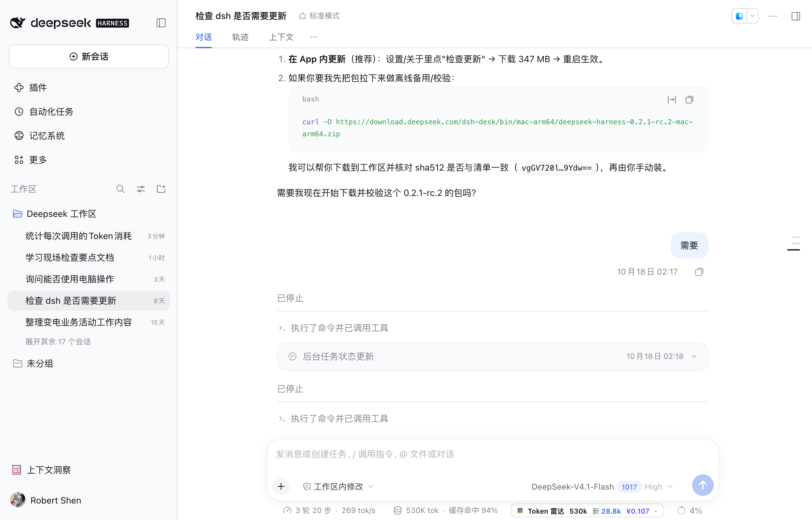
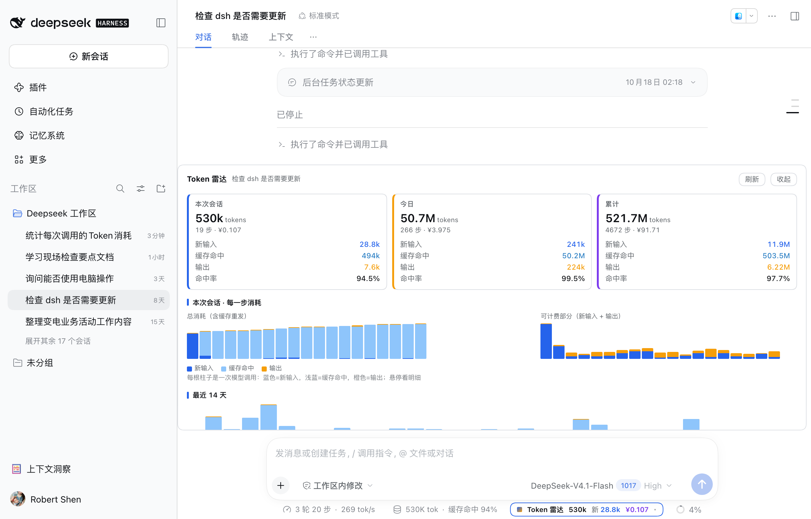

# dsh-token-radar · Token 雷达

中文 | [English](README.en.md)

DeepSeek Harness 的前台 token 计量插件：输入框下方常驻一条计量条，点开是完整的消耗面板。





## 它显示什么

**收起态**（默认就在输入框下面那一行，紧挨状态栏，胶囊形，约 240px 宽）

```
● Token 雷达 · 本次会话 530k  新输入 28.8k  命中率 94.5%  估算费用 ¥0.107   ▁▂▃▅▆  详情
```

最后的小柱状图是最近 18 次调用的消耗序列。

**展开态**

| 区块 | 内容 |
|---|---|
| 三张卡 | 本次会话（蓝）/ 今日（橙）/ 累计（紫）：总量、步数、费用、新输入、缓存命中、输出、命中率 |
| 本次会话 · 每一步消耗 | 左右两张图：**总消耗**（含缓存重发）与**可计费部分**（新输入+输出）；每根柱是一次调用，悬停看明细 |
| 配色 | 新输入=蓝 `#2563eb`、缓存命中=浅蓝 `#8ec5fb`、输出=橙 `#f59e0b`、累计/费用=紫 `#7c3aed`，不依赖主题色 |
| 最近 14 天 | 每日堆叠柱 |
| 子代理消耗 | 按父子树列出每个子代理的步数、token、费用（无子代理时自动隐藏） |
| 工具开销归因 | 每次工具调用的次数与「后续上下文增量」分摊值 |
| 按模型 | 各模型的 token、费用、占比 |

数据每 8 秒自动刷新（页面隐藏时暂停），也可点「刷新」。

## 口径

- 数字全部来自会话日志里模型返回的 `usage`（`inputTokens` / `cacheReadTokens` / `cacheWriteTokens` / `outputTokens` / `reasoningTokens`），不是估算。
- **新输入** = 未命中缓存的输入；**缓存命中** = 命中前缀缓存的输入（约为前者 1/30 价）；**输出** 含推理。
- 工具本身不调用模型、不计费；「工具开销归因」是把 `下一步上下文增量 − 上一步输出` 按各工具结果长度分摊的估算值。
- 子代理是独立会话，带 `parentSession`，已按父子树汇总。
- 费用按 off-peak 价估算（flash 0.007 / 0.22 / 0.66 USD per 1M，pro 0.022 / 0.66 / 1.98），×7.2 折算人民币。

## 去重（否则会翻倍）

日志里有两类重复，插件都处理了：

1. 同一 `session id` 存在 v0/v3/v4 迁移副本 → 取步数最多、版本最高的一份；
2. 子代理/继续会话的日志把父会话历史整段复制（时间戳完全相同）→ 按 `(时间, 轮, 步, 输入, 缓存命中, 缓存写入, 输出)` 全局去重。

校验：与管理端 cost-meter 账本逐日比对，10 天里 5 天完全一致，其余差 1 次内部小调用（约 0.01%）。

## 结构

| 文件 | 作用 |
|---|---|
| `index.js` | Host 半：读 `~/.dsh/sessions/**/*.zstd`（自实现多帧 zstd 解码）、解析、去重、聚合，注册 `GET /dsh-token-meter/stats` |
| `client.js` | Client 半：胶囊注册在 `conversation.composer.dock`、面板注册在 `conversation.input.dock`，两者共用模块级 store，`fetch` 同源路由，纯 CSS 图表，无第三方依赖 |
| `cordis.patch.yml` | 插入插件行 `token-radar` |
| `locale/*.json` | 插件市场/设置里显示的名称与说明（中英） |
| `icon.svg` | 插件图标 |

## 安装与生效

```sh
dsh plugin --profile <你的 profile> add dsh-token-radar
# 本地目录安装：
dsh plugin --profile <你的 profile> add /path/to/dsh-token-radar
```

本机已通过 `plugin_manager install_bundle` 安装进 `desktop` profile（`~/.dsh/profiles/desktop/package.json` 里以 `link:` 方式指向本目录）。

安装完成后需要**重启 Harness**：desktop profile 的 bundle 列表在进程启动时组合，运行中的进程不会热加载新 bundle。菜单栏 **DeepSeek Harness → 重启应用与 Host** 即可，不必手动退出。

客户端模块同样在页面启动时按 revision 装配，且该应用没有刷新快捷键，因此改完 `client.js` 也要走一次「重启应用与 Host」。

版式分两处注册：

- **收起态**：`conversation.composer.dock`（输入框下面那一行），做成约 240px 的胶囊 `● Token 雷达 530k 新 28.8k ¥0.107 ▸`，只放总量/新输入/费用，完整数字在悬停提示里，窄窗口自动隐藏次要字段，不会把状态栏文字挤成省略号；
- **展开态**：`conversation.input.dock`（输入框上方），在文档流内向上生长、挤压对话区，所以详情面板不会盖住底部状态栏，也不会被窗口底边裁掉——输入框在最下方，向下没有空间，向上是唯一不遮挡的选择。

## 性能

首次扫描 142 个日志文件（71 MB 压缩）约 2.2 秒；之后按文件 size+mtime 做增量，命中缓存时一次请求约 10–30 ms。文档缓存 TTL 2.5 秒，避免轮询反复扫描。
